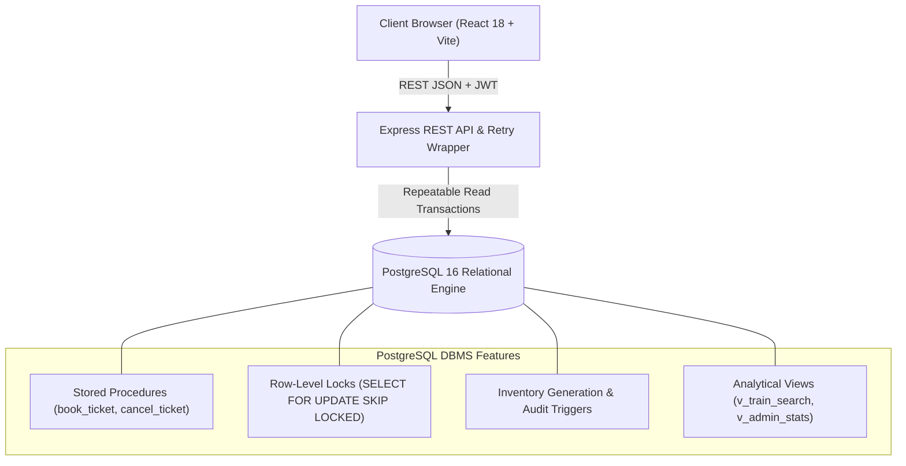

# 🚄 Smart Railway Reservation System

[](https://github.com/railstream/smart-railway-reservation/actions/workflows/ci.yml)
[](https://www.postgresql.org/)
[](https://nodejs.org/)
[](https://react.dev/)
[](https://vitejs.dev/)
[](LICENSE)

An enterprise-grade, high-concurrency railway reservation platform engineered with **PostgreSQL 16**, **Express.js**, and **React 18 + Vite**. Built specifically to eliminate race conditions, double-bookings, and phantom allocations through **Repeatable Read Isolation**, **Row-Level Pessimistic Locking (`SELECT ... FOR UPDATE SKIP LOCKED`)**, and **atomic FIFO waitlist promotions**.

---

## 🌟 Key Highlights

- 🔒 **Zero Double-Booking Guarantee**: Mathematical row-level locking ensures that simultaneous booking requests never allocate the same physical seat twice.
- ⚡ **Atomic Waitlist FIFO Promotion**: When a confirmed reservation is cancelled, the earliest waitlisted passenger is automatically promoted to confirmed and allocated the released seat in a single atomic transaction.
- 🛡️ **ACID Certified Rollbacks**: Simulated payment gateway failures trigger clean `SAVEPOINT` rollbacks, leaving zero orphaned booking or passenger records.
- 📐 **Strict 3NF Schema**: 12 relational tables normalized to Third Normal Form to eliminate insertion, update, and deletion anomalies.
- 💎 **Modern Glassmorphic UI**: Ultra-responsive dark mode interface featuring live train route search, coach seat layout visualizer, interactive boarding pass with PNR inquiry, and administrative KPI telemetry.

---

## 🏗️ System Architecture



---

## 🗄️ Relational Schema (3NF)

The schema comprises 12 tables + audit log normalized to 3NF:
1. `users`: Passenger and administrator user accounts with bcrypt hashed credentials.
2. `stations`: Master station records with unique IR codes (NDLS, MMCT, etc.).
3. `trains`: Train master registry with classification (Rajdhani, Shatabdi, Superfast).
4. `train_stops`: Route schedule and sequential distance milestones (composite PK).
5. `schedules`: Date-specific operational runs.
6. `coaches`: Class coach configurations (SL, 3A, 2A).
7. `seats`: Physical berth allocations (Lower, Middle, Upper, Side Lower, Side Upper).
8. `seat_inventory`: Schedule-specific status (`FREE`, `BOOKED`) with version counter.
9. `bookings`: Master booking records with 10-digit sequence-generated PNR.
10. `passengers`: Individual traveler information linked to assigned seat and status.
11. `payments`: Payment audit trail with gateway method and status.
12. `waiting_list`: FIFO queue tracking positions when coaches are at capacity.
13. `audit_log`: Append-only trigger log recording all inventory changes.

---

## 🚀 Quick Start Guide

### Prerequisites
- [Docker](https://www.docker.com/) & Docker Compose
- [Node.js 20+](https://nodejs.org/) and `npm`

### 1. Clone & Set Environment
```bash
git clone https://github.com/<your-username>/smart-railway-reservation.git
cd smart-railway-reservation
cp .env.example .env
```

### 2. Start PostgreSQL Database
```bash
docker-compose up -d
```
*This starts PostgreSQL 16 on port 5432 and automatically executes all migration scripts (`db/01_schema.sql` through `db/07_generate_inventory.sql`).*

*(Optional) pgAdmin 4 is available at `http://localhost:5050` (Email: `admin@railway.com` / Password: `AdminPassword123!`).*

### 3. Start Backend API
```bash
cd backend
npm install
npm run dev
```
*Backend runs on `http://localhost:5000` with health check at `http://localhost:5000/api/health`.*

### 4. Start Frontend Client
```bash
cd ../frontend
npm install
npm run dev
```
*Frontend opens at `http://localhost:5173` with automatic API proxying.*

---

## 🧪 Verification & Concurrency Stress Test

### Automated Race Condition Simulation
Execute the automated concurrency stress script simulating 50 concurrent buyers competing for 1 remaining seat:
```bash
node scripts/run_concurrency_demo.js
```

### Jest Test Suite
Run comprehensive integration and ACID tests:
```bash
cd backend
npm test
```

Test coverage includes:
- `concurrency.test.js`: 50 concurrent requests competing for 1 free seat yields exactly 1 Confirmed and 49 Waiting list entries.
- `payment_failure.test.js`: Simulated payment failure triggers rollback leaving zero residual rows.
- `waitlist.test.js`: Cancellation automatically promotes top waitlisted passenger and updates positions.

---

## 👥 Default Demo Credentials

| Role | Email | Password | Permissions |
| :--- | :--- | :--- | :--- |
| **Admin** | `admin@railway.com` | `Admin@123` | Full access, KPI metrics, fleet management |
| **Passenger 1** | `user1@railway.com` | `User@123` | Search, book tickets, cancel reservations |
| **Passenger 2** | `user2@railway.com` | `User@123` | Multi-user booking & waitlist contender |

---

## 📁 Repository Structure

```
smart-railway-reservation/
├── .github/workflows/ci.yml       # Automated CI pipeline
├── backend/                       # Express REST API
│   ├── src/
│   │   ├── config/                # PostgreSQL pool configuration
│   │   ├── controllers/           # Route controllers (auth, bookings, admin, etc.)
│   │   ├── middleware/            # JWT auth, role validation, error handling
│   │   ├── routes/                # Express endpoint routers
│   │   ├── services/              # BookingService with stored procedure calls
│   │   └── utils/retry.js         # SQLSTATE 40001 / 40P01 retry wrapper
│   ├── tests/                     # Concurrency and ACID Jest test suites
│   ├── server.js                  # Server entry point
│   └── package.json
├── db/                            # PostgreSQL DDL & DML scripts
│   ├── 01_schema.sql              # 3NF relational schema
│   ├── 02_indexes.sql             # Performance indexes
│   ├── 03_functions.sql           # book_ticket, cancel_ticket stored procedures
│   ├── 04_triggers.sql            # Audit logging & inventory triggers
│   ├── 05_views.sql               # Search & admin analytical views
│   ├── 06_seed.sql                # 16 stations, 6 trains, seed users
│   ├── 07_generate_inventory.sql  # 60-day seat inventory generator
│   └── demo/                      # Standalone SQL demo scripts
├── docs/                          # Comprehensive technical documentation
│   ├── ARCHITECTURE.md            # System architecture & 3NF analysis
│   ├── API_REFERENCE.md           # REST endpoint documentation
│   └── BENCHMARK_AND_CONCURRENCY.md # Concurrency stress report
├── frontend/                      # Modern React 18 + Vite web app
│   ├── src/
│   │   ├── api/client.js          # Fetch API client
│   │   ├── components/            # Navbar, Footer, SeatMapModal, BookingModal
│   │   ├── context/AuthContext.js # Auth state & toast manager
│   │   ├── pages/                 # Home, PNRStatus, MyBookings, Admin, Auth
│   │   ├── index.css              # Custom CSS design system
│   │   └── main.jsx
│   └── vite.config.js
├── postman/                       # Postman test collection
├── scripts/                       # High-concurrency race condition demo
├── docker-compose.yml             # Container orchestration
└── README.md
```

---

## 📄 License

Distributed under the MIT License. See [LICENSE](LICENSE) for more information.
