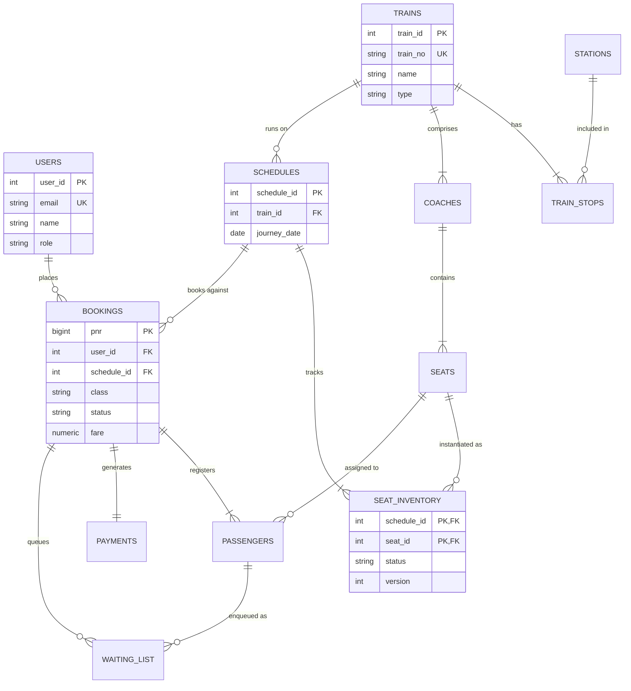

# 🏛️ System Architecture & Database Design

## 1. System Overview

The **Smart Railway Reservation System** is an enterprise-grade relational database and web platform engineered for high-concurrency ticket reservations, atomic transaction isolation, and automated waitlist FIFO promotion.

```
+-------------------------------------------------------------------------+
|                              Frontend Client                            |
|             (React 18 + Vite + Modern Glassmorphic Design System)       |
+------------------------------------+------------------------------------+
                                     |  HTTP REST / JSON (JWT)
                                     v
+-------------------------------------------------------------------------+
|                            Backend API Layer                            |
|        (Express.js + Node.js 20+ + Auto-Retry SQLSTATE Wrapper)         |
+------------------------------------+------------------------------------+
                                     |  Connection Pool (pg, max: 30)
                                     v
+-------------------------------------------------------------------------+
|                  PostgreSQL 16 Advanced DBMS Engine                     |
|                                                                         |
|  - Repeatable Read Transaction Isolation                                 |
|  - Row-Level Pessimistic Locking (SELECT ... FOR UPDATE)                |
|  - Lock Skipping for Queue Consumers (SKIP LOCKED)                     |
|  - Atomic Stored Procedures (book_ticket, cancel_ticket)                 |
|  - Automatic Audit Logging & Inventory Triggers                         |
|  - 3NF Normalized Schema across 12 Relational Tables                    |
+-------------------------------------------------------------------------+
```

---

## 2. Relational Schema & 3NF Normalization

The schema is partitioned into **12 relational tables** plus an immutable `audit_log` table, rigorously normalized to Third Normal Form (3NF):

### 1NF (Atomic Attributes)
- All columns store single, atomic values. Composite attributes like berth type and coach are split into distinct fields.
- Multi-valued passenger data are separated into a dedicated `passengers` table linked by foreign key (`pnr`).

### 2NF (No Partial Functional Dependencies)
- Every non-key column is fully functionally dependent on the primary key.
- In `train_stops` (composite PK: `train_id`, `stop_seq`), all attributes (`arrival_time`, `departure_time`, `distance_km`) depend on the whole composite key.

### 3NF (No Transitive Dependencies)
- No non-prime attribute is transitively dependent on any candidate key.
- Stations, trains, coaches, and schedules each maintain their own independent master tables with referential integrity constraints (`ON DELETE CASCADE` / `ON DELETE RESTRICT`).

### Entity Relationship Diagram (ERD)



---

## 3. High-Concurrency Transaction Isolation

### The Double-Booking Race Condition
When thousands of passengers compete simultaneously for the last remaining seat on a high-demand route (e.g. Rajdhani Express during Tatkal/holiday rush):
1. **Under Read Committed**: Multiple transactions read `status = 'FREE'` at time $t_0$. Both attempt to update to `'BOOKED'` at $t_1$. One overwrites the other, resulting in duplicate allocations for the exact same physical berth.
2. **Under Repeatable Read + Row-Level Locking (`SELECT ... FOR UPDATE`)**:
   - The transaction locks the specific candidate seat rows in `seat_inventory`.
   - Concurrent transactions attempting to lock the same row either wait for the lock to release or skip locked rows via `SKIP LOCKED`.
   - If an isolation serialization conflict arises (`SQLSTATE 40001` or `40P01`), our Node.js retry wrapper (`withRetry`) automatically catches the error and retries with jittered exponential backoff.

### Automatic Waitlist FIFO Promotion
When a confirmed booking is cancelled via `cancel_ticket(pnr, user_id)`:
1. The cancelled seat is identified.
2. The stored procedure locks the earliest waitlisted passenger (`ORDER BY position ASC LIMIT 1 FOR UPDATE SKIP LOCKED`).
3. If a waitlisted passenger exists:
   - The passenger status is changed from `WAITING` to `CONFIRMED`.
   - The seat is assigned immediately to that passenger.
   - All subsequent waitlisted entries for that schedule decrement their `position` by 1 (`UPDATE waiting_list SET position = position - 1`).
4. If no waitlist exists, the seat status resets to `'FREE'`.
5. All operations take place inside an atomic transaction, leaving zero room for race conditions or leaked seats.
